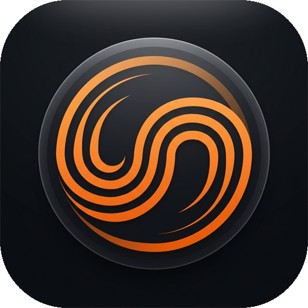

  
  <h1>Sonora</h1>
  
<strong>Pemutar Musik Offline Hi-Res, AutoEQ 10-Band, ReplayGain, Smart Backup, Sonora Connect Handoff &amp; Full-Length Downloader (Windows Desktop &amp; Android)</strong>

  

    
  

  

    
    
    
    
  

  

    <a href="#unduh-aplikasi-sonora-v142">Unduh Aplikasi</a>
    &nbsp;&bull;&nbsp;
    <a href="#lokasi-penyimpanan-lagu-backup--binari">Lokasi Storage &amp; Bin</a>
    &nbsp;&bull;&nbsp;
    <a href="#spesifikasi-minimum--rekomendasi">Spesifikasi Minimum</a>
    &nbsp;&bull;&nbsp;
    <a href="#tutorial-lengkap-sonora-connect-handoff--remote">Tutorial Sonora Connect</a>
    &nbsp;&bull;&nbsp;
    <a href="#kompatibilitas-os-android--hp-low-end">Kompatibilitas OS &amp; HP Lawas</a>
  

---

## Unduh Aplikasi (Sonora v1.4.3)

Repositori ini merupakan **Pusat Distribusi Rilis & Pembaruan Otomatis (Auto-Updater Hub)** untuk aplikasi **Sonora**. Pilih paket instalasi sesuai perangkat Anda:

| Platform | File Installer / Paket | Ukuran | Keterangan |
| :--- | :--- | :--- | :--- |
| **Windows Desktop (64-bit)** | [**`Sonora-Setup-v1.4.3-Windows-x64.exe`**](https://github.com/HillarioRZA/Sonora/releases/download/v1.4.3/Sonora-Setup-v1.4.3-Windows-x64.exe) | **17.46 MB** | Installer mandiri Windows 10/11 x64 + pilihan bebas folder Instalasi & folder Data (Storage & Bin) |
| **Android (64-bit ARM)** | [**`Sonora-v1.4.3-Android-arm64.apk`**](https://github.com/HillarioRZA/Sonora/releases/download/v1.4.3/Sonora-v1.4.3-Android-arm64.apk) | **27.42 MB** | APK rilis resmi bertanda tangan keystore permanen (mendukung update langsung tanpa uninstall) |
| **Semua Rilis & Catatan Versi** | [**Halaman GitHub Releases**](https://github.com/HillarioRZA/Sonora/releases) | - | Riwayat versi lengkap & catatan pembaruan |

> **Pembaruan Otomatis Dalam Aplikasi (In-App Auto-Update)**: Jika Anda sudah memasang Sonora `v1.3.0`, `v1.4.0`, atau `v1.4.1`, cukup buka aplikasi Sonora (atau tekan **Cek Pembaruan** di tab **Studio**), lalu tekan **Perbarui** ketika popup pembaruan muncul.

---

## Lokasi Penyimpanan Lagu, Backup & Binari

| Jenis File | Lokasi di Android (File Manager HP) | Lokasi di Windows Desktop (Bebas Diatur ke Drive D/E) |
| :--- | :--- | :--- |
| **Lagu Unduhan & Lirik (`.lrc`)** | **`Internal Storage/Sonora/Music/`** (`/storage/emulated/0/Sonora/Music/`) | `<Folder Data Pilihan>\storage\library\` (default: `%LOCALAPPDATA%\Sonora\storage\library\`) |
| **File Backup (`.sonora-bak`)** | **`Internal Storage/Sonora/Backup/`** (`/storage/emulated/0/Sonora/Backup/`) | `<Folder Data Pilihan>\storage\backups\` |
| **Binari Desktop (`yt-dlp` / `ffmpeg`)** | Tidak dibutuhkan (Pure-Rust Native M4A) | `<Folder Data Pilihan>\bin\` |

> **Mengubah Drive Penyimpanan di Windows Desktop**: Anda bisa langsung memilih drive/folder tujuan (`D:\SonoraData`, `E:\Sonora`, dll.) saat menjalankan installer **`Sonora-Setup-v1.4.3-Windows-x64.exe`**, atau kapan saja dari dalam aplikasi lewat tab **Studio -> Mesin Unduhan, Pembaruan & Izin -> Penyimpanan -> Ubah Lokasi Storage & Bin** (data lagu, database, dan `yt-dlp`/`ffmpeg` otomatis ikut dipindahkan tanpa kehilangan koleksi).

---

## Spesifikasi Minimum & Rekomendasi

### 1. Android (`arm64-v8a`)

| Komponen | Spesifikasi Minimum | Spesifikasi Rekomendasi |
| :--- | :--- | :--- |
| **Sistem Operasi** | **Android 7.0 (Nougat / API 24)** atau lebih baru | **Android 9.0 (Pie / API 28)** ke atas (mendukung hardware `DynamicsProcessing` 10-Band AutoEQ penuh) |
| **Kompatibilitas Merek / ROM** | **Semua merek Android**: Samsung OneUI, OPPO ColorOS, vivo FuntouchOS/OriginOS, realme UI, Xiaomi MIUI/HyperOS, Asus ZenUI, Infinix XOS, Motorola, Google Pixel / Custom ROM AOSP | Semua ROM Android 9+ (dengan dukungan ekstra metadata *HyperIsland* bila dijalankan di Xiaomi HyperOS) |
| **Prosesor (CPU)** | 64-bit ARM (`arm64-v8a`, Snapdragon seri 400/600 lawas, MediaTek Helio, Exynos, Unisoc) | Octa-core 64-bit `arm64-v8a` |
| **RAM** | **2 GB RAM** (disarankan mengaktifkan *Mode Hemat GPU / Tanpa Blur Real-Time* di tab Studio) | **4 GB RAM** atau lebih |
| **Penyimpanan** | **100 MB** ruang kosong untuk aplikasi + ruang penyimpanan sesuai koleksi lagu offline | **1 GB+** ruang kosong untuk koleksi FLAC/M4A offline |

### 2. Windows Desktop (`x64`)

| Komponen | Spesifikasi Minimum | Spesifikasi Rekomendasi |
| :--- | :--- | :--- |
| **Sistem Operasi** | **Windows 10 (64-bit, versi 1903+)** | **Windows 10 / Windows 11 (64-bit)** |
| **Prosesor (CPU)** | Dual-Core 64-bit (`x86_64`, Intel Celeron / Core i3 Gen-4 / AMD Athlon atau setara; beban CPU idle `< 0.5%`) | Quad-Core 64-bit (`x86_64`, Intel Core i5 / AMD Ryzen 3 ke atas) |
| **RAM** | **4 GB RAM** (pemakaian RAM aplikasi hanya ~290-320 MB) | **8 GB RAM** atau lebih |
| **Grafis (GPU)** | GPU terintegrasi DirectX 11 (tersedia *Mode Hemat GPU* tanpa efek blur real-time untuk laptop lawas) | GPU terintegrasi/diskrit DirectX 11+ untuk tampilan kaca *Nocturne Glass* 60-120 FPS |
| **Penyimpanan** | **150 MB** ruang kosong (bebas ditempatkan di Drive C/D/E) | SSD dengan **2 GB+** ruang kosong untuk koleksi Hi-Res Lossless |

---

## Tutorial Lengkap Sonora Connect (Handoff & Remote)

**Sonora Connect** memungkinkan Anda memindahkan pemutaran musik dari HP Android ke PC Windows (atau dari PC ke HP) secara instan pada posisi detik yang sama, serta mengendalikan pemutaran dari jarak jauh tanpa memicu suara ganda (**Single Active Sink / Anti Dual Play**).

### 1. Cara Memasangkan Perangkat Pertama Kali (Wi-Fi LAN / Hotspot)
1. Pastikan **HP Android** dan **PC Windows** berada di jaringan **Wi-Fi yang sama** (atau nyalakan *Hotspot* di HP lalu sambungkan PC ke Hotspot tersebut).
2. Buka **Sonora** di kedua perangkat, lalu ketuk ikon **Perangkat** (ikon layar & ponsel di Mini-Player, bar bawah Desktop, sudut kanan atas layar **Now Playing**, atau melalui **Studio -> Sonora Connect -> Perangkat**).
3. **Di Perangkat Penerima (misalnya PC Windows)**: Ketuk **Buat PIN** untuk memunculkan **PIN 6-Digit** (berlaku 60 detik) beserta alamat `IP:Port` lokal (contoh: `192.168.1.12:41891`).
4. **Di Perangkat Pengirim (misalnya HP Android)**: Ketuk **Cari Perangkat**, ketuk nama PC yang muncul di daftar **Ditemukan di LAN**, masukkan **PIN 6-Digit**, lalu ketuk **Pasangkan**.
5. Setelah terpasang satu kali, kedua perangkat tersimpan permanen di daftar **Perangkat Terpasang**.

### 2. Cara Memindahkan Lagu (Handoff) & Mode Remote Kontrol
1. Buka menu **Sonora Connect**, lalu ketuk tombol **Pindahkan** di samping nama perangkat tujuan.
2. Audio di perangkat pengirim otomatis berhenti, perangkat tujuan langsung memutar lagu tersebut tepat di posisi detik yang sama (lewat file lokal jika ada, atau streaming langsung dari perangkat pengirim), dan perangkat pengirim berubah menjadi **Remote Kontrol (`REMOTE_MIRROR`)**.
3. Untuk menarik kembali suara ke perangkat semula, ketuk **Dengarkan di Perangkat Ini** atau ketuk lagu mana pun di daftar **Koleksi** lokal.

### 3. Menggunakan Sonora Connect Lewat Tailscale (Lintas Jaringan)
Aktifkan **Tailscale** di kedua perangkat, catat IP Tailscale perangkat tujuan (`100.x.y.z`), tekan **Buat PIN** di perangkat tujuan, lalu masukkan IP Tailscale + Port (`41891`) + PIN pada bagian **Pasangkan Perangkat / Peer IP Manual (Tailscale)** di perangkat pengirim.

---

## Kompatibilitas OS Android & HP Low-End

1. **Kompatibilitas Penuh di Semua Merek Android (Non-HyperOS)**: Parameter *HyperIsland* hanyalah metadata tambahan standar Android yang otomatis diabaikan dengan aman di Samsung OneUI, OPPO ColorOS, vivo FuntouchOS, realme UI, Infinix, Asus, Motorola, maupun Pixel/AOSP (tetap menampilkan kontrol MediaStyle & Lockscreen standar Android).
2. **Optimasi Khusus HP Lawas / Low-End**: Audio default berjalan dalam mode **Pure Bypass** (0 beban filter DSP), tersedia toggle **Mode Hemat GPU (Tanpa Blur Real-Time)** di tab **Studio**, serta pembekuan otomatis seluruh timer/FFT saat layar mati atau aplikasi di latar belakang.

---

## Lisensi & Pengembang

Dikembangkan oleh **Reza Pratama** ([@HillarioRZA](https://github.com/HillarioRZA)).